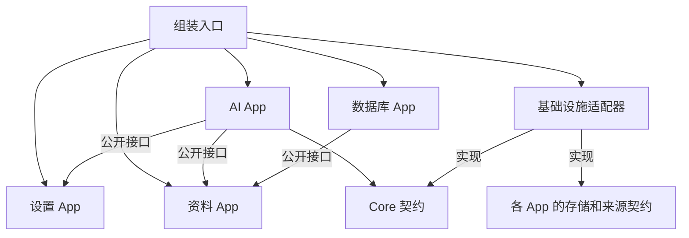

# Core 与 App 模块架构方案

状态：步骤 1–5 已实施，步骤 6 的具体 AI 应用尚未开始。2026-10-31。

Phone 以 App 模块组织业务。每个模块拥有自己的数据、业务流程、页面和公开接口；Core 提供底层机制；入口负责组装依赖。其他应用通过数据所属模块取得能力，使数据来源、修改入口和运行责任可追溯。现有 App 已完成模块迁移，生产和预览共用 `src/bootstrap/create-phone.tsx` 组装。

## 职责与数据归属

| 模块           | 拥有或负责                                                        | 对外能力                                             |
| -------------- | ----------------------------------------------------------------- | ---------------------------------------------------- |
| Core           | AI 传输契约、宿主聊天身份与通知契约                               | 创建绑定连接快照的 Pi `streamFn`；读取和订阅当前聊天 |
| 设置 App       | 全局壁纸选择、图库操作、模型连接及默认连接；连接测试流程          | 壁纸读取与订阅、连接摘要、连接配置快照               |
| 资料 App       | 外部资料接入、Phone 查询结构、查询缓存、背景资料快照              | 背景读取、SQL 结构描述、只读查询、来源变化订阅       |
| 数据库 App     | SQL 草稿、对象搜索、选中项、查询结果展示和滚动状态                | 首期仅消费资料接口，无需专门跨应用接口               |
| AI App         | 自己的模型选择、Agent、提示词、工具、运行策略、业务内容及保存时机 | 按实际业务声明，例如消息查询或日记读取               |
| 秒表与组件 App | 自身计时或演示交互                                                | 当前无需公开业务能力                                 |
| 手机外壳       | 窗口、Home、Expose、页面挂载和前后台展示状态                      | 向应用传递界面生命周期事实                           |
| 基础设施适配器 | ST 请求和保存、Memory 协议、具体存储接线                          | 实现 Core 或 App 声明的依赖契约                      |
| 组装入口       | 创建实例、注入依赖、连接宿主通知                                  | 确保使用方得到同一所有者提供的实例                   |

App 模块覆盖业务与页面。模块的公开能力不依赖页面先打开，也不会因为页面卸载自动失效。设置仍可在后台提供连接；资料仍可在数据库或 AI 应用使用时执行查询。

“归属资料 App”表示 Phone 内部的数据接入与查询责任归该模块。原始 Memory 记录仍由 Memory 拥有，ST 聊天记录仍由宿主拥有。其他应用保存的消息、日记等业务数据继续归对应应用，资料模块不自动获得它们的所有权。

## Core 的范围

### AI 传输

Core 对外以 Pi 的 `StreamFn` 契约为中心，统一请求、流协议转换、取消传递与错误表达。生产实现通过 ST 同源代理发送请求；文本、工具调用和思考内容按声明支持的能力转换成 Pi 事件。工具调用的流解析由传输实现完成，工具执行由应用的 Agent 负责。

公开契约如下；使用项目锁定版本的 Pi 类型，避免重新定义一套消息、工具和流事件协议：

```ts
interface AiConnection {
  readonly baseUrl: string;
  readonly apiKey: string;
  readonly customHeaders: Readonly<Record<string, string>>;
}

interface AiTransport {
  createStream(connection: AiConnection): StreamFn;
}
```

`createStream` 固定该次传输使用的连接副本。模型由应用通过 Pi 调用参数传入，设置中保存的模型 ID 可作为应用的选择来源。Core 可以提供协议要求的模型对象构造能力，不能擅自选择默认连接或覆盖应用模型。

应用决定 Agent 数量、复用范围、提示词、历史、工具、超时参数、重试和取消时机。传输执行调用方提供的信号和参数，不读取当前 App、当前默认连接或 ST 主连接作为隐含输入。每次调用的流状态独立，失败依照 Pi 契约结束流；不自动重放请求或工具操作。不支持的内容明确报错。

连接测试中的 ST 请求与流转换已迁到 `infrastructure/host/ai-transport.ts`，测试提示词、输出限制、60 秒超时和 Agent 留在设置模块。生产传输保持文本能力，工具与思考输入明确拒绝；工具和思考支持留待实际应用需求。Phone 不导入相邻仓库文件，也不依赖 Memory 私有运行能力。预览替换 `AiTransport`，与生产执行同一设置测试流程。

### 当前聊天

Core 声明当前聊天的稳定身份、展示名称及变化通知，由 ST 适配器实现。该能力独立于 Memory 可用性。资料模块另行维护 `sourceId` 和 `scopeId`，描述外部资料的身份与范围。

```ts
interface PhoneChat {
  readonly id: string;
  readonly name: string;
}

interface ChatContext {
  getSnapshot(): PhoneChat | null;
  subscribe(listener: () => void): () => void;
}
```

`null` 表示当前没有可归属的聊天。已实现的 ST 适配器以角色 avatar 或群组 ID 加聊天文件名组成身份；角色列表重排不改变身份，文件重命名、复制和分支产生新身份。该身份用于活动文件归属，不承诺跨文件重命名保持同一业务 ID；未来业务持久化需按自身规则处理迁移。适配器订阅 ST 聊天变化、聊天重命名、角色重命名和群组更新，先更新快照再通知。状态未变时返回稳定引用，不依赖 Memory。

Core 不保存所有应用的业务数据，不管理全局 Agent 池，不承担应用任务调度。首次整理不建立通用事件总线、动态插件注册或任意键值业务仓库。

## App 公开接口

每个需要被其他应用调用的模块提供 `public.ts`，导出公开契约及返回值类型。跨 App 调用只依赖这个入口；实现类、存储接口、页面和内部状态不能通过该入口整体导出。模块不需要共享能力时不创建空接口。

读取返回只读快照或副本，调用方不修改所有者内部对象。写入使用明确业务方法，由所有者执行校验、保存和通知。查询与写入发生错误时应明确报告，禁止以空结果掩盖来源失败。`subscribe` 返回取消订阅函数，调用者负责释放自己的订阅。

### 设置 App

设置公开两个按用途划分的读取接口，完整定义位于 `src/apps/settings/public.ts`：

```ts
interface WallpaperReader {
  getSnapshot(): WallpaperSnapshot;
  subscribe(listener: () => void): () => void;
}

interface ModelConnectionsReader {
  getSnapshot(): ModelConnectionsSnapshot;
  subscribe(listener: () => void): () => void;
  getConnection(id: string): ModelConnectionSnapshot;
}
```

`WallpaperSnapshot` 包含当前壁纸选择、可用图片 URL 与 Blur；`ModelConnectionsSnapshot` 包含连接摘要和可空的默认连接 ID；`ModelConnectionSnapshot` 为显式读取的完整连接副本，含模型 ID 和鉴权。不存在的连接明确报错，未选择默认连接保持空值，使用哪个连接由调用应用决定。

设置内部保留保存连接、选择默认、上传图片和设定壁纸等命令。其他应用需要修改设置时，再把具体操作加入公开接口，不先暴露整份设置替换能力。完整连接仅在需要发起请求时读取；这些接口属于代码依赖约定，不构成同一 JavaScript 环境中的安全隔离。

生产仍使用 `extensionSettings.ste_phone`、ST 延迟保存和原生壁纸目录。接口整理不改变设置 schema，也不把延迟保存的返回误称为服务端持久化确认。

### 资料 App

资料模块同时提供便捷的背景读取和只读 SQL 查询，统一来源接入及查询结构管理。背景读取在模块内部使用自己的查询能力，不再依赖数据库 App 的编辑工作区。

```ts
interface DataAppPublic {
  getSnapshot(): DataSourceSnapshot;
  subscribe(listener: () => void): () => void;
  readBackground(request: BackgroundRead): Promise<PhoneBackground>;
  describe(request: DataScope, options?: { readonly force?: boolean }): Promise<DatabaseSchema>;
  query(request: DataQuery): Promise<QueryResult>;
}
```

`DataSourceSnapshot` 表达当前聊天、来源、资料范围、背景读取状态及数据是否过期；`sourceId` 在取得结构或背景前为 `null`，`revision` 用于消费方识别来源变更；`DataScope` 显式携带请求的聊天和资料范围；`DataQuery` 另外包含 SQL 与参数；`BackgroundRead` 另外表达是否强制刷新。`describe` 的 `force` 保留数据库手动刷新的行为。查询结果沿用现有列、行和截断信息，背景快照沿用现有固定快照语义。

显式请求归属用于校验请求与结果。当前 Memory 只承诺活动上下文查询，切换后可以拒绝旧请求；这个接口不承诺随时查询历史聊天。数据更新使缓存过期，新读取按现有规则重新加载。已交付的背景快照保持不变，应用自行决定正在进行的生成是否继续使用它。

当前实现范围仍为 Memory 已提交数据库上的 `src_*` 与 `phone_*` 结构，以及人物、纪要和物品快照。SQL 草稿、编辑器查询错误、搜索和滚动不进入该接口。

ST 聊天记录的读取与未来 SQL 暴露归资料模块负责，但当前尚未实现。宿主聊天记录如何成为可查询结构、使用哪个执行引擎、与 Memory 查询能否联合执行，需作为后续功能设计；本次不添加假表、不承诺跨来源 JOIN，也不改变现有 Memory 查询架构。

### 数据库与未来 AI App

数据库 App 依赖资料公开接口，持有自己的工作区状态，通过 `describe` 和 `query` 实现对象浏览与执行 SQL。原来的按聊天和资料范围保留工作区规则继续有效。

AI App 按需要接收 `AiTransport`、`ChatContext`、`ModelConnectionsReader` 和 `DataAppPublic`。应用读取连接副本、取得资料、创建 Agent，并保存自己的业务结果。应用未来公开消息或日记时，也在自己的 `public.ts` 声明；其他应用不直接读取它的存储。

## 生命周期和持久化

手机外壳负责页面显示和卸载，Core 提供聊天变化事实，App 决定业务运行如何响应。界面事实至少能区分前台、后台、手机窗口关闭和 Expose 明确退出，具体接线可沿用 props 与显式回调，不要求引入统一生命周期基类。当前 `active` 仍可用于显示刷新和焦点控制，但不足以代替所有生命周期事实。

| 事件                | 系统职责                       | App 自行决定                     |
| ------------------- | ------------------------------ | -------------------------------- |
| Home 或切换前台应用 | 更新可见性与前后台状态         | 是否继续生成、更新进度或暂停显示 |
| 关闭手机窗口        | 通知窗口隐藏，保留现有页面会话 | 运行是否继续                     |
| Expose 退出         | 明确通知退出并卸载页面         | 取消任务、继续后台任务或保存草稿 |
| 切换 ST 聊天        | 发布新聊天上下文               | 取消、保留旧运行或启动新会话     |
| 刷新 ST             | 内存运行随页面结束             | 哪些已保存内容在下次启动恢复     |

后台业务运行由 App 模块持有，卸载页面只结束其 UI 订阅。若应用决定退出时取消，应由应用显式处理退出通知。首轮结构整理保留各现有应用的行为：连接测试离开相关页面或卸载时取消，Home 和关闭手机保留；秒表仍按现有页面会话生存。新应用可以制定不同策略。

跨应用遵守的共同约束是归属清晰：运行固定自己的业务目标和配置；A 聊天产生的结果不得按完成时的当前聊天写入 B。是否因切换取消、是否允许向旧聊天保存，由应用策略及存储能力共同决定。无法按目标身份保存时明确失败，不写入其他聊天。

各应用声明自己的存储依赖，基础设施提供实现，应用决定保存时机和恢复内容。全局配置继续归设置；消息、日记等数据归所属应用。第一个业务应用实现时再确定实际存储介质、聊天分支行为和数据版本，当前不引入通用业务持久化层。

## 目标目录

按 App 聚合业务与 UI，以便从目录直接确认所有权。下列树列出当前主要布局，AI App 为未来位置；内部文件按实际职责创建，无需为简单应用补齐空层次。

```text
src/
  bootstrap/
    create-phone.tsx              # 组装模块与界面，接收宿主或预览适配器
  core/
    ai/
      public.ts                   # AiTransport、连接传输输入、Pi 类型
    chat/
      public.ts                   # ChatContext、PhoneChat
  apps/
    settings/
      public.ts
      settings-service.ts
      model-connections.ts
      ports/                      # 设置与图片存储契约
      ui/                         # 页面、草稿、弹窗与 CSS
    data-source/
      public.ts
      data-service.ts              # 来源上下文、查询与结构管理
      background.ts               # 背景类型与快照读取
      ports/                      # 外部来源契约
      ui/
    database/
      database-workspace.ts
      ui/
    stopwatch/
      ui/
    foundation/
      ui/                         # 组件示例应用
    <ai-app>/                     # 首个具体 AI 应用出现时建立
      public.ts                   # 有实际调用方时再建立
      ...                         # 本应用 Agent、业务、存储契约和 UI
  infrastructure/
    host/
      ai-transport.ts             # Pi StreamFn 的 ST 实现
      chat-context.ts
      st-settings.ts
    ste-memory/                   # 资料来源适配、映射和协议
  frontend/
    index.ts                      # 保留构建入口，调用 bootstrap
    phone-app.tsx
    host/
    device/
      app-lifecycle.ts            # AppDefinition、可见性与明确退出通知
    system/
    apps/home/                    # 手机桌面，保留为外壳组成部分
    foundation/                   # 共享视觉组件
    theme.css
```

预览入口继续在 `docs/ui/`，注入模拟 AI、聊天和来源适配器；生产模块不导入预览资源。业务测试随所属模块迁移，传输与宿主测试留在适配器旁。迁移 App CSS 时同步调整聚合导入，不改变 Shadow DOM 样式约定。

## 依赖规则与组装



箭头表示代码依赖或显式组装关系。Core 不导入 App；App 业务逻辑不导入 React、ST 全局对象或基础设施实现；App UI 可以依赖自身业务与共享 Foundation。跨 App 依赖只经过目标 App 的公开接口，模块自身的 `ports/` 供组装入口与适配器实现使用。

组装入口可以导入实现并连接实例，向每个应用注入它需要的接口。React Context 仅用于方便界面取得依赖，业务逻辑仍显式接收参数。禁止给全部 App 注入一个可任意取服务的全局容器，避免依赖关系隐藏在运行时查找中。

跨 App 依赖保持有向无环。出现循环时先检查业务归属与操作发起方，不通过事件总线掩盖循环，也不把含业务的数据迁到 Core。公开读取方法与通知属于同一数据所有者，调用方不维护第二份可独立修改的权威数据。

## 整理顺序与验收

| 步骤 | 结构调整                                       | 完成标志                                                 |
| ---- | ---------------------------------------------- | -------------------------------------------------------- |
| 1    | 将设置、资料和数据库的公开契约及所有权落到模块 | 消费者能从类型入口确认数据来源；原功能行为保持           |
| 2    | 拆分资料查询能力与数据库编辑工作区             | 资料不再依赖数据库 App；两者仍共用同一资料服务           |
| 3    | 按 App 迁移业务与 UI，集中生产和预览组装       | App 内部实现不被其他 App 导入；构建与样式引用正确        |
| 4    | 提取 Core AI 传输及 ST 实现，接回连接测试      | 测试流程仍由设置管理，协议处理只有一份实现               |
| 5    | 补独立聊天上下文与明确界面生命周期通知         | 无 Memory 时仍可识别 ST 聊天；退出策略仍由应用执行       |
| 6    | 接入第一个具体 AI App                          | 应用自行管理 Agent、业务存储和任务策略，消费既有公开接口 |

步骤 1 至 5 已完成，步骤 6 为后续业务开发。`phone/app-boundaries` Lint 规则约束 Core 与 App 的依赖方向、跨 App 公开入口及业务层与 UI 的分离。ST 聊天记录 SQL、通用任务中心、跨应用工具目录、动态安装应用及持久任务恢复均不包含在首轮整理中。

实施时运行项目规定的类型、构建与相关测试，并按前端验收约定核对生产和预览。重点验证：设置页面未启动也能读取配置；退出设置不影响壁纸读取；数据库工作区与资料查询互不污染；模型配置副本不随运行期间编辑改变；请求失败、截断和取消能够正确结束；聊天切换后结果归属明确。工具支持加入时使用真实 Agent 循环验证流转换与工具执行之间的契约。

## 与已有决策的关系

本方案延续 [0002](adr/0002-memory-executes-phone-views.md) 的 Memory 执行 Phone 视图、[0004](adr/0004-uploaded-wallpaper-library.md) 的壁纸存储，以及 [0005](adr/0005-phone-ai-connections-and-pi-runtime.md) 的独立连接与 Pi 基础。0005 中尚未确定的共享运行能力在这里限定为传输能力，Agent 管理归 App。

[0003](adr/0003-retained-app-navigation-and-settings.md) 的页面保留与 Expose 卸载规则继续有效。本方案补充页面与业务模块的生命周期区别，不统一改变现有 App 的任务行为。结构决策摘要见 [0006](adr/0006-app-owned-public-interfaces-and-core.md)。

## 主屏与应用商店

内置应用的稳定 ID 和静态目录定义在 `core/launcher/catalog.ts`，供设置、外壳和商店共同使用；页面与运行定义仍由 bootstrap 组装。设置模块持有 v4 全局配置，通过 `HomeScreenSettings` 提供布局快照与安装、卸载、移动命令。两个有序数组记录主屏与 Dock，成员表示已安装；商店不再持有第二份安装状态。卸载不会删除应用的业务数据，主屏在设置保存成功后请求外壳退出对应会话；商店安装成功后将入口追加到主屏，通过注入的 `onOpen` 请求系统打开应用。运行中应用的 `onQuit` 与既有 Expose 退出规则相同，资料、设置、App Store 的卸载权限由目录与设置命令共同约束。
